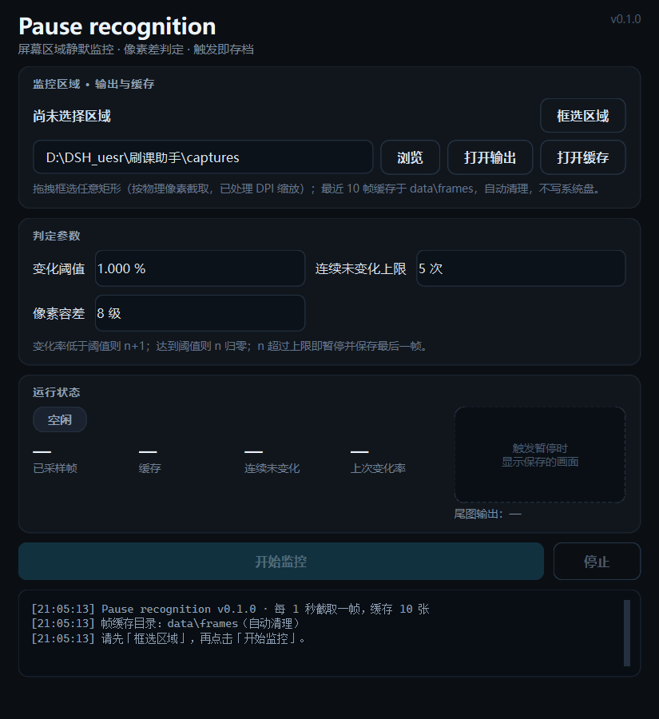

# Pause recognition

屏幕区域「静默」监控器：框选屏幕上任意一块区域，程序每秒截取一帧并比对像素差异；当画面**连续 N 次几乎没有变化**时自动暂停监控，并把最后一张截图（尾图）无损保存到你指定的目录。它不在屏幕上持续显示缩略图，只在需要时留下一份证据。



| 监控中 | 已暂停（触发后） |
| --- | --- |
|  |  |

## 功能

- **任意区域框选**：全屏半透明遮罩，鼠标拖拽选择；支持多显示器，按物理像素截取（已处理 125% / 150% 等 DPI 缩放）。
- **1 帧/秒采样**：内存环形缓存固定保留最近 **10** 帧，超出自动淘汰最早的一帧。
- **缓存落在程序目录**：这 10 帧同时镜像到 `<程序目录>\data\frames\`，磁盘上同样只保留 10 张；**不写 C 盘用户目录**。
- **像素差判定**：逐像素比较 RGB，任一通道差值超过「像素容差」（默认 8 级）才算该像素发生变化；变化率 = 变化像素 / 总像素 × 100%。
- **未变化计数**：变化率 **低于阈值** → `n += 1`；任一次 **达到阈值** → `n = 0` 重新累加。
- **触发暂停**：`n > 上限`（严格大于，例如上限 5 时第 6 次触发）→ 暂停监控，把尾图以无损 PNG 复制到「尾图输出目录」。
- **缓存保留**：触发后不清空那 10 帧缓存，随时可「继续监控」。
- **恢复语义**：继续后第一帧作为新基准、不参与计数，计数器归零，避免暂停期间的变化被误计。
- **参数持久化**：阈值、上限、容差、输出目录写入 `<程序目录>\data\config.json`，下次启动自动恢复。

## 判定规则

```text
changed(x, y) = max(|ΔR|, |ΔG|, |ΔB|) > tolerance
ratio         = changed_pixels / total_pixels * 100

if ratio <  threshold_percent : n += 1
else                          : n  = 0

if n > max_unchanged          : 暂停监控 + 输出尾图（缓存保留）
```

举例：1920×1080 区域、阈值 `1%`，则约 **20736 个像素**发生变化才算「有变化」。默认「像素容差 8 级」用于吸收视频噪点、抗锯齿与轻微渐变，避免误报。

## 文件放在哪

| 用途 | 位置 | 说明 |
| --- | --- | --- |
| 10 帧监控缓存 | `<程序目录>\data\frames\` | 自动保留最近 10 张，开始/停止监控时清理；退出程序后保留最后一组便于查看 |
| 配置文件 | `<程序目录>\data\config.json` | 阈值、上限、容差、输出目录 |
| 尾图输出 | 默认 `<程序目录>\captures\`，可自行选择 | 触发暂停时写入无损 PNG |

所有“程序自己用”的文件默认都留在**程序所在目录**（源码运行时即项目根目录，打包后即 exe 所在目录），不会往 C 盘用户目录写。只有程序目录不可写时（例如装在 `Program Files`）才退回 `%APPDATA%\PauseRecognition`。

## 环境与安装

- Windows 10/11
- Python 3.10+（开发环境 3.12.10）
- 依赖：PySide6、mss、numpy、Pillow

```powershell
python -m pip install -r requirements.txt
```

## 运行

```powershell
python run.py
# 或
python -m app
```

使用步骤：

1. 点击 **框选区域**，在屏幕上拖拽出要监控的矩形（`Esc` / 右键取消）。
2. 设置 **变化阈值**、**连续未变化上限**、**像素容差**（可随时修改，立即生效）。
3. 选择 **尾图输出目录**（默认 `<程序目录>\captures`）；点 **打开缓存** 可查看那 10 帧。
4. 点击 **开始监控**；状态变为「监控中」，每秒采样一次。
5. 触发后状态变为「已暂停」，日志与预览区显示输出的文件，点击 **继续监控** 继续。

## 触发后保存

- 文件格式：无损 PNG，文件名 `pause_YYYYMMDD-HHMMSS.png`。
- 同一秒内多次触发会自动追加序号，**绝不覆盖**历史文件。
- 输出目录不存在时自动创建。

## 项目结构

```text
app/
  buffer.py       # 10 帧内存环形缓存
  cache.py        # 10 帧磁盘镜像（后台线程写 PNG，自动淘汰）
  capture.py      # mss 截屏（物理像素 → RGB ndarray）
  config.py       # 参数持久化 + 旧配置迁移
  controller.py   # 1 fps 调度：截屏 → 判定 → 缓存 → 保存
  diff.py         # 逐像素比对与变化率
  main.py         # 应用入口（DPI 感知 + 装配）
  paths.py        # 程序目录 / 数据目录 / 缓存 / 输出路径
  saver.py        # 尾图 PNG 落盘
  screens.py      # Win32 显示器枚举与逻辑/物理坐标映射
  selection.py    # 全屏框选遮罩
  state.py        # 未变化计数状态机
  ui/             # PySide6 主窗口与主题
tests/            # 单元测试 + 离屏 GUI 冒烟（58 项）
scripts/
  smoke_test.py   # 真实截屏链路冒烟测试
docs/             # 界面截图
```

## 测试

```powershell
# 单元测试 + 离屏 GUI 冒烟（58 项）
python -m unittest discover -s tests -t .

# 真实链路冒烟：截屏 → 判定 → 触发 → 落盘 → 检查缓存目录
python scripts\smoke_test.py --seconds 10 --max-unchanged 1
```

`smoke_test.py` 退出码：`0` 成功触发并写出 PNG，`2` 窗口内画面一直在变未触发，`1` 出错。

## 打包（可选）

```powershell
python -m pip install pyinstaller
pyinstaller --noconfirm --windowed --name PauseRecognition run.py
```

打包后 `data/` 与 `captures/` 会生成在 exe 同目录，整个文件夹可以整体拷走。

## 已知限制

- mss 只截取屏幕像素，**不包含鼠标指针**（指针变化不会触发计数）。
- 锁屏、切换分辨率、显卡驱动重置时截屏可能失败，程序会停止监控并弹窗提示。
- 10 帧 1080p 内存缓存约占 60 MB；磁盘缓存约 3–10 MB（取决于画面复杂度，PNG 无损）。
- 选区会被夹紧到虚拟桌面范围内。
- 多显示器缩放比例不同时，跨屏框选的边缘可能存在几像素误差；单屏内框选精确。
