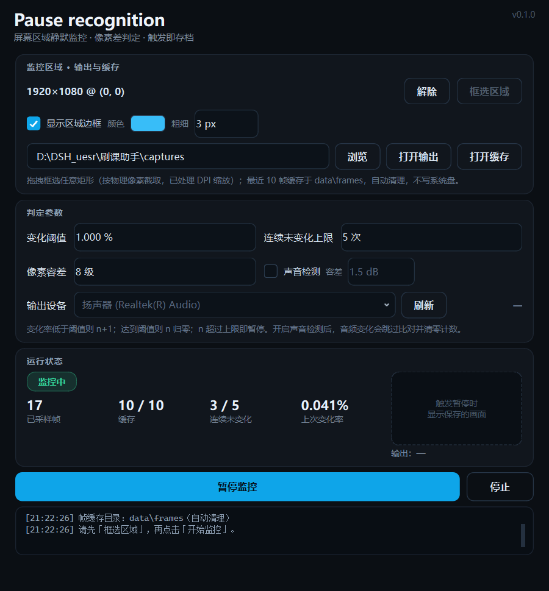
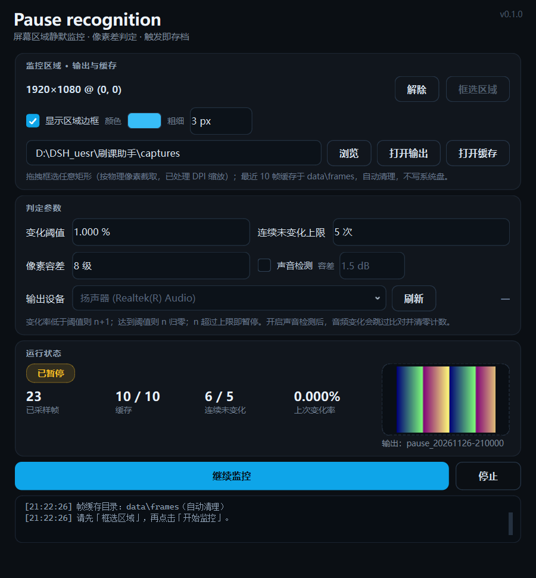

# Pause recognition

屏幕区域「静默」监控器：框选屏幕上任意一块区域，程序每秒截取一帧并比对像素差异；当画面**连续 N 次几乎没有变化**时自动暂停监控，并把最后一张截图与选框位置保存到你指定的目录。它不在屏幕上持续显示缩略图，只在需要时留下一份证据。


| 监控中 | 已暂停（触发后） |
| --- | --- |
|  |  |

## 功能

- **任意区域框选**：全屏半透明遮罩，鼠标拖拽选择；支持多显示器，按物理像素截取（已处理 125% / 150% 等 DPI 缩放）。
- **随时解除框选**：点「解除」即可清空区域、边框与缓存；正在监控时会先自动停止。
- **常驻区域边框**：框选后始终标出监控范围，可选颜色、可调粗细（1–20 px）、可开关；窗口置顶且鼠标穿透，并通过 `WDA_EXCLUDEFROMCAPTURE` 排除在截图之外，**不会污染像素比对**。
- **可选声音门控**：自动枚举本机音频输出设备（WASAPI loopback），可指定监听哪一块声卡；开启后只有相邻两次采样之间音量变化不超过容差时，才做像素比对。音频变化会跳过本次比对并清零连续计数——避免“画面静止但有声音”被误判为静止。
- **1 帧/秒采样**：内存环形缓存固定保留最近 **10** 帧，超出自动淘汰最早的一帧。
- **缓存落在程序目录**：这 10 帧同时镜像到 `<程序目录>\data\frames\`，磁盘上同样只保留 10 张；**不写 C 盘用户目录**。
- **像素差判定**：逐像素比较 RGB，任一通道差值超过「像素容差」（默认 8 级）才算该像素发生变化；变化率 = 变化像素 / 总像素 × 100%。
- **未变化计数**：变化率 **低于阈值** → `n += 1`；任一次 **达到阈值** → `n = 0` 重新累加。
- **触发暂停**：`n > 上限`（严格大于，例如上限 5 时第 6 次触发）→ 暂停监控，在「触发输出目录」下生成一个以时间命名的文件夹，内含尾图 `tail.png` 与选框位置 `region.json`。
- **缓存保留**：触发后不清空那 10 帧缓存，随时可「继续监控」。
- **恢复语义**：继续后第一帧作为新基准、不参与计数，计数器归零，避免暂停期间的变化被误计。
- **参数持久化**：阈值、上限、容差、输出目录写入 `<程序目录>\data\config.json`，下次启动自动恢复。

## 判定规则

```text
changed(x, y) = max(|ΔR|, |ΔG|, |ΔB|) > tolerance
ratio         = changed_pixels / total_pixels * 100

# 可选：声音门控
if audio_enabled:
    if 本次区间电平 与 上次区间电平 之差 > audio_tolerance_db:
        跳过本次像素比对, n = 0        # 音频在变化 = 区域不算静止
    else:
        允许像素比对

if ratio <  threshold_percent : n += 1
else                          : n  = 0

if n > max_unchanged          : 暂停监控 + 生成截图文件夹（缓存保留）
```

举例：1920×1080 区域、阈值 `1%`，则约 **20736 个像素**发生变化才算「有变化」。默认「像素容差 8 级」用于吸收视频噪点、抗锯齿与轻微渐变，避免误报。

声音门控的电平是每个采样区间（约 1 秒）的 RMS，换算成 dBFS 后与上一区间比较；默认容差 1.5 dB。静音时电平约 -180 dBFS，因此静音与静音之间判为「不变」。

## 文件放在哪

| 用途 | 位置 | 说明 |
| --- | --- | --- |
| 10 帧监控缓存 | `<程序目录>\data\frames\` | 自动保留最近 10 张，开始/停止监控时清理；退出程序后保留最后一组便于查看 |
| 配置文件 | `<程序目录>\data\config.json` | 阈值、上限、容差、输出目录、边框、音频设备与容差 |
| 触发输出 | 默认 `<程序目录>\captures\`，可自行选择 | 每次触发生成一个文件夹：`tail.png` + `region.json` |

所有“程序自己用”的文件默认都留在**程序所在目录**（源码运行时即项目根目录，打包后即 exe 所在目录），不会往 C 盘用户目录写。只有程序目录不可写时（例如装在 `Program Files`）才退回 `%APPDATA%\PauseRecognition`。

## 环境与安装

- Windows 10/11
- Python 3.10+（开发环境 3.12.10）
- 依赖：PySide6、mss、numpy、Pillow、soundcard（声音检测）

```powershell
python -m pip install -r requirements.txt
```

## 运行

```powershell
.\run.bat          # 双击也可以，会自动挑选装好依赖的解释器
# 或者
python run.py
```

> **必须用装过 `requirements.txt` 的 Python**（本机是 `D:\python\3.12.10\python.exe`）。
> LibreOffice、Inkscape 等软件自带的 `python.exe` 里没有 PySide6，会提示缺少依赖。

使用步骤：

1. 点击 **框选区域**，在屏幕上拖拽出要监控的矩形（`Esc` / 右键取消）；想取消时点 **解除**。
2. 用 **显示区域边框 / 颜色 / 粗细** 调整常驻边框；设置会立即生效并记住。
3. 设置 **变化阈值**、**连续未变化上限**、**像素容差**（可随时修改，立即生效）。
4. 需要更严格的静止判定时，勾选 **声音检测**，选择要监听的 **输出设备**，按需调整 **容差**（默认 1.5 dB）；右侧实时显示电平。
5. 选择 **触发输出目录**（默认 `<程序目录>\captures`）；点 **打开缓存** 可查看那 10 帧。
6. 点击 **开始监控**；状态变为「监控中」，每秒采样一次。
7. 触发后状态变为「已暂停」，日志与预览区显示输出的文件夹，点击 **继续监控** 继续。

## 触发后保存

每次触发生成一个文件夹：

```text
captures\pause_20261126-204301\
  tail.png       # 触发帧，无损 PNG
  region.json    # 选框位置、显示器布局与触发参数
```

`region.json` 的关键字段：

```json
{
  "created_at": "2026-11-26T20:43:01+08:00",
  "capture": {"file": "tail.png", "width": 480, "height": 320},
  "region": {
    "left": 720, "top": 380, "width": 480, "height": 320,
    "right": 1200, "bottom": 700, "monitor": "\\\\.\\DISPLAY1"
  },
  "screen": {"virtual": {"left": 0, "top": 0, "width": 1920, "height": 1080},
             "monitors": [{"device": "\\\\.\\DISPLAY1", "left": 0, "top": 0,
                           "width": 1920, "height": 1080, "primary": true}]},
  "trigger": {"threshold_percent": 1.0, "max_unchanged": 1, "unchanged": 2},
  "audio": {"enabled": false, "device": "", "level_dbfs": null}
}
```

- `region` 是**物理像素**坐标，可直接用于二次截图、定位或交给其他处理者。
- 同一秒内多次触发会自动追加序号（`..._1`），**绝不覆盖**历史文件夹。
- 输出目录不存在时自动创建。

## 项目结构

```text
app/
  audio.py        # 音频输出设备枚举与 loopback 电平采集
  border.py       # 常驻区域边框（置顶、鼠标穿透、排除截图）
  buffer.py       # 10 帧内存环形缓存
  cache.py        # 10 帧磁盘镜像（后台线程写 PNG，自动淘汰）
  capture.py      # mss 截屏（物理像素 → RGB ndarray）
  config.py       # 参数持久化 + 旧配置迁移
  controller.py   # 1 fps 调度：截屏 → 判定 → 缓存 → 保存
  diff.py         # 逐像素比对与变化率
  main.py         # 应用入口（DPI 感知 + 装配）
  paths.py        # 程序目录 / 数据目录 / 缓存 / 输出路径
  saver.py        # 触发截图与选框位置打包落盘
  screens.py      # Win32 显示器枚举与逻辑/物理坐标映射
  selection.py    # 全屏框选遮罩
  state.py        # 未变化计数状态机
  ui/             # 主窗口、主题与图标资源
tests/            # 单元测试 + 离屏 GUI 冒烟（90 项）
scripts/
  smoke_test.py   # 真实截屏链路冒烟测试
docs/             # 界面截图
run.py            # 启动入口（先检查依赖再启动）
run.bat           # Windows 启动脚本（自动挑选解释器）
```

## 测试

```powershell
# 单元测试 + 离屏 GUI 冒烟（90 项）
python -m unittest discover -s tests -t .

# 真实链路冒烟：截屏 → 判定 → 触发 → 落盘 → 检查缓存目录
python scripts\smoke_test.py --seconds 10 --max-unchanged 1
```

`smoke_test.py` 退出码：`0` 成功触发并写出 PNG，`2` 窗口内画面一直在变未触发，`1` 出错。

## 打包（可选）

```powershell
python -m pip install pyinstaller
pyinstaller --noconfirm --windowed --name PauseRecognition `
  --add-data "app/ui/assets;app/ui/assets" `
  --collect-all soundcard run.py
```

打包后 `data/` 与 `captures/` 会生成在 exe 同目录，整个文件夹可以整体拷走。

## 常见问题

**`ModuleNotFoundError: No module named 'PySide6'`？**

用错了解释器。常见于拿 `C:\Program Files\LibreOffice\program\python.exe`、Inkscape 自带的 Python 去跑本项目——它们只服务于自己那套环境，没有 PySide6。
改用装过依赖的解释器：

```powershell
python run.py        # 本机的 python 指向 D:\python\3.12.10\python.exe
.\run.bat            # 或者直接双击，脚本会自动挑选
```

VS Code 里按 `Ctrl+Shift+P` → `Python: Select Interpreter`，选择 `D:\python\3.12.10\python.exe`，再按 `F5` / `Ctrl+F5` 运行。

## 已知限制

- mss 只截取屏幕像素，**不包含鼠标指针**（指针变化不会触发计数）。
- 锁屏、切换分辨率、显卡驱动重置时截屏可能失败，程序会停止监控并弹窗提示。
- 10 帧 1080p 内存缓存约占 60 MB；磁盘缓存约 3–10 MB（取决于画面复杂度，PNG 无损）。
- 选区会被夹紧到虚拟桌面范围内。
- 多显示器缩放比例不同时，跨屏框选的边缘可能存在几像素误差；单屏内框选精确。
- 常驻边框依赖 Windows 10 2004+ 的 `WDA_EXCLUDEFROMCAPTURE`；更早的系统上会自动把边框画到选区外侧，此时贴边选区可能看不到边框内侧那一半。
- 边框窗口置顶显示，会覆盖在其它窗口之上（这是"时刻标注"的本意），不需要时可取消勾选。
- 声音检测依赖 WASAPI loopback：被独占模式占用的声卡可能无法录制；设备被拔出时程序会跳过像素比对并在日志提示。
- 声音门控比较的是**相邻两个采样区间的 RMS 电平**：持续播放且音量稳定的声音会被判为"不变"；只有电平变化才会阻止比对。若希望"有任何声音就视为活动"，可以再改判定口径。
- 音频电平受播放内容影响较大，默认容差 1.5 dB 偏严格；音乐/视频场景可适当调大到 2–4 dB。
